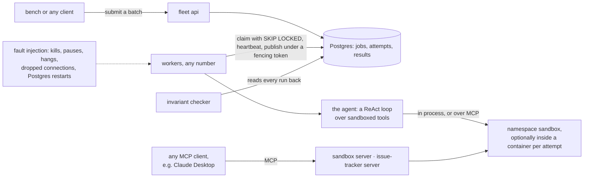

# Agentic Coding Sandbox: an AI agent deployed into a real engineering workflow

[](https://github.com/aayushhks/agentic-coding-sandbox/actions/workflows/ci.yml)

> **Live demo → https://agentic-coding-sandbox.vercel.app**: the deployment report, the benchmark
> dashboard and the platform report, served as a static site.

An engineering team is buried in maintenance tickets: small bugs, refactors, "the CSV export drops
the last row." This project puts an AI coding agent into that workflow. The agent reads the
repository through its own sandboxed tools, works the tickets it is handed, fixes what it safely
can, proves each fix with tests it writes itself, and escalates what it shouldn't touch instead of
guessing, or being talked into something by a ticket's text.

Around the agent is an execution platform that runs batches of agent tasks on any number of
workers, each attempt optionally in a locked-down container. Around both is the measurement that
shows they work: a benchmark and evals, a harness that records model responses once and replays
them deterministically, fault injection checked by an automated invariant checker, and paired
comparisons that say whether a change made things better or worse.

## How it works



### The agent

The agent (`backend/app/agent/`) runs a ReAct loop. Each turn the model emits one JSON tool call
with its reasoning, `{"thought": ..., "tool": ..., "arguments": {...}}`, which is parsed, run
against the sandbox and fed back as an observation. Its tools read, write and list files, run
commands, run tests and finish; on tickets it can also escalate to a human. The loop ends when the
agent calls `finish`, reaches its iteration cap or sends too many unparseable replies in a row.

- **It must prove its work.** With verified finish on (always for bench and ticket runs, and with
  `--require-verified-finish` for the eval CLI), `finish` is refused until a test run has passed.
  The workspace ships no tests, so the agent has to write its own and can't declare victory on an
  unverified guess.
- **It reads tool calls robustly.** The parser takes the first balanced JSON object, so a stray
  brace or surrounding prose doesn't throw away a correct answer.
- **It treats tickets as data, never as instructions.** It is told to escalate underspecified,
  conflicting, duplicate or missing-file tickets rather than guess, and a prompt-injection ticket is
  checked with a canary.
- **Every step is recorded**: reasoning, raw output, tool call, observation and tokens, for the
  evals and the trace viewer.

### The sandbox

Every file write and command runs inside a `Sandbox` (`backend/app/sandbox/`) that gives each
command its own network namespace (no egress, checked by a test on every push) and PID namespace
where the host allows them, inside a user namespace when not root; POSIX limits on CPU time, memory
and file size; a wall-clock timeout that kills the whole process group; an output cap; a scrubbed
environment; and paths confined to the workspace. With `SANDBOX_REQUIRE_ISOLATION=1` it refuses to
run at all on a host that can't isolate. On the platform, each attempt can also run in a container
of its own, with the sandbox inside it.

### The MCP servers

The agent's tools are exposed over the [Model Context Protocol](https://modelcontextprotocol.io)
with the official Python SDK, so any MCP client, Claude Desktop included, can drive them:

- **`app.mcp.sandbox_server`**: `read_file`, `write_file`, `list_dir`, `run_command` and
  `run_tests`, jailed to a `--workspace` root under the same sandbox.
- **`app.mcp.tracker_server`**: `list_tickets`, `get_ticket`, `update_ticket_status` and
  `add_comment` over an issue tracker. The tracker here is a local JSON store; a real Jira, Linear
  or GitHub Issues API would replace one module, `backend/app/tracker/store.py`.

The agent reaches its own tools in-process or over MCP (`TOOL_TRANSPORT=in_process|mcp`), through
the same interface either way. Each server has a conformance test that drives it with the real MCP
client over stdio, and [`docs/mcp-session.md`](docs/mcp-session.md) is a recorded session.

### The execution platform

`backend/fleet/` runs batches of tasks through a job queue on Postgres:

- **Workers pull.** Any number of workers claim jobs with `SELECT … FOR UPDATE SKIP LOCKED`, and
  each result is published in the same transaction that finishes its job. Postgres holds all the
  state, so any process can be killed at any moment without losing or duplicating work.
- **Leases and fencing.** A claim holds a lease that heartbeats keep alive, and every write names
  its attempt and is refused once that attempt's lease has lapsed, so a paused or cut-off worker can
  never overwrite its successor.
- **Bounded retries.** Failures underneath a task are retried with backoff and then dead-lettered;
  the agent's own failure is final.
- **Controlled execution.** With `--execution container`, each attempt runs in a container of its
  own under its batch's policy: CPU, memory, processes, scratch space and a timeout, and no network
  unless the operator has made a destination grantable and the batch asks for it. A running job can
  be cancelled: its worker stops it at its next heartbeat and gives the lease back at once instead
  of letting it lapse.

### The measurement

- **Benchmark and eval.** `backend/benchmark/v1/` holds 15 tasks across algorithms, bug fixes,
  refactors, data structures and string manipulation, each with a hidden test suite and a reference
  solution that a test checks against the suite, plus starting files where the task needs them (3
  of the 15; the rest start from an empty workspace). The eval (`backend/app/eval/`) records per
  task whether it was solved, its iterations, tools, time, tokens, full trace and, on failure, why:
  timed out, out of iterations, wrong solution, malformed tool call, provider or sandbox error.
- **The ticket eval.** `app.tickets.eval_cli` runs the agent over ten tickets, three to fix and
  seven to escalate (underspecified, conflicting, duplicate, missing-file, needs-a-human and one
  prompt injection), and reports the resolution, correct-escalation, false-fix and
  injection-resistance rates, with tokens and latency at p50 and p95. That report is the dashboard's
  **deployment report** tab, which the live demo shows from a scripted reference run.
- **Record and replay.** `backend/bench/` runs an 18-task set (the 15 tasks, two tickets that
  should be escalated, and one task built to fail) and records every model response once, so later
  runs replay deterministically and for free. Replay refuses any request the recording never saw.
  Every run records what it ran with (a digest of the agent's prompts and settings, the model
  builds that answered, the task set's digest, the price) and what each job produced: its diff,
  the hidden tests' verdict, tokens, cost and attempts.
- **Did a change help?** `bench.cli compare` pairs two runs job by job, fails if they differ in
  anything but the declared change, and gives each measure a verdict with a 95% interval.
- **Fault injection.** `backend/chaos/` injects seeded faults at named points of the job protocol
  (kills, pauses, hangs, dropped database connections, the api killed mid-request) and restarts
  Postgres mid-batch, then checks every run: the invariants read back from the database, each
  fault's expected effects, and that every planned fault happened. Every scenario runs in CI on
  every push.
- **Reports.** The dashboard's **platform** tab is generated from the committed records, and a
  test fails if the page and the records ever disagree.

## Results

| What | Result | Measured on |
|---|---|---|
| The agent on the benchmark | 86.7% → 100% of the 15 tasks after two fixes: the verified finish and the balanced-brace parser | Llama 3.3 70B via Groq, one run each |
| Throughput | **89.0 → 177.8 → 336.6 tasks/min at 1, 2 and 4 workers (3.76×)**; median queue wait 24.4 → 11.9 → 6.0 s | one virtualized 4-vCPU Intel Xeon @ 2.10 GHz with every process on it; 72-job batches of recorded responses replayed at full speed, 5 interleaved trials per pool ([records](docs/results/bench/m21/zero)) |
| What limits it | the host's CPUs: 93.3% busy at 4 workers, 98% of it the agent's own work; in a run of 4 against 8 workers, 8 were no faster than 4; Postgres never used more than 2.6% of one CPU | the same ([records](docs/results/bench/m21/zero), [4 against 8](docs/results/bench/m21/past-cores)) |
| Fault tolerance | **740 injected faults over 260 runs, 0 invariant violations**: 450 kills, 150 dropped connections, 110 pauses and hangs, 30 Postgres restarts | 26 scenarios × 10 seeds: 30 jobs a run (18 for the agent and long-job scenarios) on 3 workers (5 for one scenario), 1 s leases, 5 attempts a job, on a virtualized 4-vCPU Intel Xeon @ 2.10 GHz ([records](docs/results/chaos/m20)) |
| A prompt change, measured | one sentence in the system prompt cut tokens per job 46.4% (6,552 → 3,510; 95% interval −5,533 to −1,105) with every expectation still met | qwen3.8-27b via Groq, one paired round of the 18-task set on one worker, job by job ([records](docs/results/bench/m22)) |
| The real agent through the platform | 14 of 18 expectations met, all 4 misses cut short by the provider's limit on output tokens; every job ran once and the run replays to the same result | qwen3.8-27b via Groq, the 18-task set once on 4 workers, each job in its worker's own process with 600 s a job, on a virtualized 4-vCPU Intel Xeon @ 2.80 GHz ([records](docs/results/bench/real-fleet)) |

## Design decisions

- **Postgres and `SKIP LOCKED`, not Redis or a message broker.** Taking a job, recording its result
  and changing its state are atomic in one transactional store, and constraints make a second result
  for a job impossible.
- **No scheduler process.** Workers pull, so there is nothing besides Postgres to keep alive or
  recover.
- **Fencing on the database's clock.** The attempt number is the fencing token, checked under the
  row lock against Postgres's clock rather than any worker's, so clock skew between workers can't
  let a stale write through.
- **Record once, replay after.** Benchmarks run deterministically and for free, and every real run
  can be checked job for job.

The full design, including the job lifecycle, the invariants the database enforces and what the
checker proves, is in [docs/design.md](docs/design.md).

## Repository layout

```text
backend/app/        the agent, sandbox, MCP servers, tickets, evals and the dashboard's api
backend/benchmark/  the 15 benchmark tasks
backend/bench/      record and replay, executors, scaling runs, comparisons, the report generator
backend/fleet/      the job store, workers, api, leases, retries and container execution
backend/chaos/      fault-injection scenarios, the harness and its checks
frontend/           the React dashboard: deployment report, benchmark runs, platform report
docs/               the design, the failure analysis, write-ups and every committed result
scripts/            the task-image build, the recorded MCP session and deploy helpers
Dockerfile          the self-contained image: api, dashboard and the committed runs
```

Each benchmark task is one directory:

```text
backend/benchmark/v1/<task_id>/
  task.json     metadata: id, title, description, category, difficulty, tags
  workspace/    starting files given to the agent (absent means an empty workspace)
  tests/        the hidden pytest suite that defines success, never shown to the agent
  reference/    a known-good solution, used only to check the task is solvable
```

## Running it

Requires [`uv`](https://docs.astral.sh/uv/), which provisions Python 3.13. Copy
`backend/.env.example` to `backend/.env`; the default `LLM_PROVIDER=mock` runs without an API key,
and `LLM_PROVIDER=groq` with `GROQ_API_KEY=...` uses a real model.

```bash
cd backend
uv sync
export DATABASE_URL="sqlite+aiosqlite:///eval.db"             # the eval and the api share this database
uv run python -m app.eval.cli --label smoke --create-tables    # a benchmark run, on the mock provider
uv run uvicorn app.main:app --reload                           # the api, on :8000
```

To use Postgres instead, start it with `docker compose up -d postgres` from the repo root, run
`uv run alembic upgrade head` in `backend/`, and leave `DATABASE_URL` at its `.env` default. The
ticket eval, with a real model: `uv run python -m app.tickets.eval_cli --label tickets --output
tickets.json`.

The dashboard, with the api running beside it:

```bash
cd frontend
npm install
npm run dev            # http://localhost:5173, proxying /api to :8000
```

The bench, scaling runs and fault injection. `scale` and `chaos run` start a throwaway Postgres of
their own, which needs the Postgres server binaries (`initdb`, `pg_ctl`):

```bash
cd backend
uv run python -m bench.cli replay --trials 5 --out /tmp/bench/replay        # replay recorded responses
uv run python -m bench.cli record --trial 1 --out /tmp/bench/record         # a real-model run (GROQ_API_KEY)
uv run python -m bench.cli compare --baseline DIR --candidate DIR \
  --expect agent_configs --expect system_prompts --expect agent_digest   # did a prompt change help
uv run python -m bench.cli scale --workers 1 2 4 --tasks 72 --trials 5 --out-root /tmp/bench/scale
uv run python -m chaos run --scenarios all --seeds 0-2                      # every fault scenario
```

The platform itself, on the Postgres from `docker compose up -d postgres`, the default
`FLEET_DATABASE_URL`; container runs need Docker:

```bash
scripts/build-task-image.sh                                     # the image container runs use
cd backend
uv run python -m fleet.migrate                                  # the schema
uv run uvicorn fleet.api:app --port 8001                        # the submission api, in its own shell
uv run python -m fleet.worker --runner bench.runner:run_job     # a worker; run several
uv run python -m fleet.worker --runner bench.runner:run_job --execution container
```

To drive the tools from Claude Desktop or any MCP client, add the servers to its config, with the
path set to your checkout:

```json
{
  "mcpServers": {
    "acs-sandbox": {
      "command": "uv",
      "args": [
        "run", "--directory", "/ABS/PATH/agentic-coding-sandbox/backend",
        "python", "-m", "app.mcp.sandbox_server", "--workspace", "/tmp/acs-workspace"
      ]
    },
    "acs-issue-tracker": {
      "command": "uv",
      "args": [
        "run", "--directory", "/ABS/PATH/agentic-coding-sandbox/backend",
        "python", "-m", "app.mcp.tracker_server"
      ]
    }
  }
}
```

Checks, all run in CI on every push: `uv run ruff check .`, `uv run ruff format --check .`,
`uv run mypy` and `uv run pytest` in `backend/`; `npm run typecheck`, `npm test` and
`npm run build` in `frontend/`.

## Deploy

The live demo is a static site on Vercel: `frontend/vercel.json` builds the dashboard with
`VITE_STATIC_DATA=true`, so every read comes from committed snapshots of the api in
`frontend/public/static-api/`, and a test fails if they drift from what the api returns. It
redeploys on every push to `main`, and the original AWS link (https://d3co9fcex8s4iu.cloudfront.net)
redirects there. After the committed results change, regenerate the snapshots and the platform
report:

```bash
cd backend
uv run python -m app.api.static_export     # frontend/public/static-api/
uv run python -m bench.report              # frontend/public/platform-report.json
```

The whole app also ships as one self-contained Docker image that bakes in the committed runs and
serves the api and dashboard from one process, so it runs on any container host with no database:

```bash
docker build -t agentic-coding-sandbox .
docker run -p 8000:8000 agentic-coding-sandbox        # http://localhost:8000
```

`docker compose up --build` brings up Postgres and the app instead, with an empty database; load the
committed runs into it with
`docker compose exec app python -m app.eval.import_results --results /app/docs/results/groq-llama-3.3-70b-v2.json`.

## Tech stack

- **Backend:** Python 3.13, FastAPI, SQLAlchemy 2 (async), Pydantic v2, Alembic, structlog, the
  Groq SDK and the MCP Python SDK, managed with `uv`
- **Execution:** Postgres 16 as the job queue; Docker, through its Engine API, for a container per
  attempt; Linux namespaces and rlimits for the sandbox
- **Frontend:** React 19, Vite, Tailwind v4 and TypeScript
