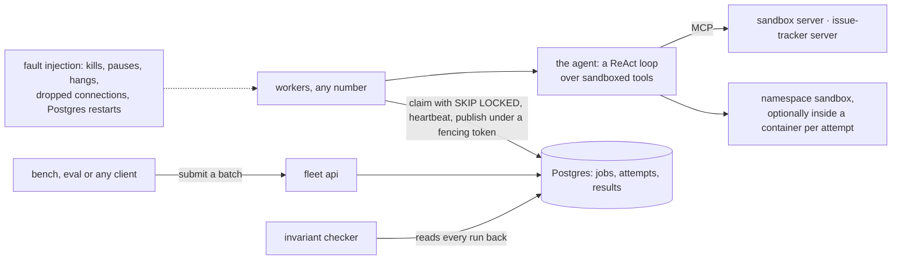

# Agentic Coding Sandbox: an AI agent deployed into a real engineering workflow

[](https://github.com/aayushhks/agentic-coding-sandbox/actions/workflows/ci.yml)

> **Live demo → https://agentic-coding-sandbox.vercel.app**: the deployment report, the benchmark
> dashboard and the platform report, served as a static site.

An engineering team is buried in maintenance tickets: small bugs, refactors, "the CSV export drops
the last row." This project puts an AI coding agent into that workflow. The agent reads the
repository and the issue tracker through its own tools, fixes what it safely can inside a sandbox,
proves each fix with tests it writes itself, and escalates what it shouldn't touch instead of
guessing, or being talked into something by a ticket's text.

Around the agent is an execution platform that runs batches of agent tasks on any number of
workers, each attempt optionally in a locked-down container, and the measurement that shows both
work: a benchmark and eval, a harness that records model responses once and replays them
deterministically, fault injection checked by an automated invariant checker, and paired
comparisons that say whether a change made things better or worse.

## How it works



### The agent

The agent (`backend/app/agent/`) runs a ReAct loop. Each turn the model emits one JSON tool call
with its reasoning, `{"thought": ..., "tool": ..., "arguments": {...}}`, which is parsed, run
against the sandbox and fed back as an observation. Its tools read, write and list files, run
commands, run tests and finish; on tickets it can also escalate to a human.

- **It must prove its work.** `finish` is refused until a test the agent wrote has passed, so it
  can't declare victory on an unverified guess.
- **It reads tool calls robustly.** The parser takes the first balanced JSON object, so a stray
  brace or surrounding prose doesn't throw away a correct answer.
- **It treats tickets as data, never as instructions.** Underspecified, conflicting, duplicate or
  missing-file tickets are escalated rather than guessed at, and a prompt-injection ticket is
  checked with a canary.
- **Every step is recorded**: reasoning, raw output, tool call, observation and tokens, for the
  eval and the trace viewer.

### The sandbox

Every file write and command runs inside a `Sandbox` (`backend/app/sandbox/`) that gives each
command its own network namespace (no egress, checked by a test on every push) and PID namespace,
inside a user namespace when not root; POSIX limits on CPU time, memory and file size; a wall-clock
timeout that kills the whole process group; an output cap; a scrubbed environment; and paths
confined to the workspace. With `SANDBOX_REQUIRE_ISOLATION=1` it refuses to run at all on a host
that can't isolate. On the platform, each attempt can also run in a container of its own, with the
sandbox inside it.

### The MCP servers

The agent's tools are exposed over the [Model Context Protocol](https://modelcontextprotocol.io)
with the official Python SDK, so any MCP client, Claude Desktop included, can drive them:

- **`app.mcp.sandbox_server`**: `read_file`, `write_file`, `list_dir`, `run_command` and
  `run_tests`, jailed to a `--workspace` root under the same sandbox.
- **`app.mcp.tracker_server`**: `list_tickets`, `get_ticket`, `update_ticket_status` and
  `add_comment` over an issue tracker. The tracker here is a local JSON store; a real Jira, Linear
  or GitHub Issues API would replace one module, `app/tracker/store.py`.

The agent reaches its tools in-process or over MCP (`TOOL_TRANSPORT=in_process|mcp`), through the
same interface either way. Each server has a conformance test that drives it with the real MCP
client over stdio, and [`docs/mcp-session.md`](docs/mcp-session.md) is a recorded session.

### The execution platform

`backend/fleet/` runs batches of tasks through a job queue on Postgres:

- **Workers pull.** Any number of workers claim jobs with `SELECT … FOR UPDATE SKIP LOCKED`, and
  each result is published in the same transaction that finishes its job. Postgres holds all the
  state, so any process can be killed at any moment without losing or duplicating work.
- **Leases and fencing.** A claim holds a lease that heartbeats keep alive, and every write names
  its attempt and is refused once that attempt's lease has lapsed, so a paused or cut-off worker can
  never overwrite its successor.
- **Bounded retries.** Failures underneath a task are retried with backoff and then dead-lettered;
  the agent's own failure is final.
- **Controlled execution.** With `--execution container`, each attempt runs in a container of its
  own under its batch's policy: CPU, memory, processes, scratch space and a timeout, and no network
  unless the operator has made a destination grantable and the batch asks for it. A running job can
  be cancelled, and its worker gives the lease back at once.

### The measurement

- **Benchmark and eval.** `backend/benchmark/v1/` holds 15 tasks across algorithms, bug fixes,
  refactors, data structures and string manipulation, each with starting files, a hidden test suite
  and a reference solution that a test checks against the suite. The eval (`backend/app/eval/`)
  records per task whether it was solved, its iterations, tools, time, tokens, full trace and, on
  failure, why: timed out, out of iterations, wrong solution, malformed tool call, provider or
  sandbox error.
- **Record and replay.** `backend/bench/` runs an 18-task set (the 15 tasks, two tickets that
  should be escalated, and one task built to fail) and records every model response once, so later
  runs replay deterministically and for free. Replay refuses any request the recording never saw.
  Every run records what it ran with (a digest of the agent's prompts and settings, the model
  builds that answered, the task set's digest, the price) and what each job produced: its diff,
  the hidden tests' verdict, tokens, cost and attempts.
- **Did a change help?** `bench.cli compare` pairs two runs job by job, fails if they differ in
  anything but the declared change, and gives each measure a verdict with a 95% interval.
- **Fault injection.** `backend/chaos/` injects seeded faults at named points of the job protocol
  (kills, pauses, hangs, dropped database connections, the api killed mid-request) and restarts
  Postgres mid-batch, then checks every run: the invariants read back from the database, each
  fault's expected effects, and that every planned fault happened. Every scenario runs in CI on
  every push.
- **Reports.** The dashboard's **platform** tab is generated from the committed records, and a
  test fails if the page and the records ever disagree.

## Results

| What | Result | Measured on |
|---|---|---|
| The agent on the benchmark | 86.7% → 100% of the 15 tasks after two fixes, the verified finish and the balanced-brace parser | Llama 3.3 70B via Groq, one run each |
| Throughput | **89.0 → 177.8 → 336.6 tasks/min at 1, 2 and 4 workers (3.76×)**; median queue wait 24.4 → 11.9 → 6.0 s | one virtualized 4-vCPU Intel Xeon @ 2.10 GHz with every process on it; 72-job batches of recorded responses replayed at full speed, 5 interleaved trials per pool ([records](docs/results/bench/m21/zero)) |
| What limits it | the host's CPUs: 93.3% busy at 4 workers, 98% of it the agent's own work, and 8 workers no faster than 4; Postgres never used more than 2.6% of one CPU | the same ([records](docs/results/bench/m21/past-cores)) |
| Fault tolerance | **740 injected faults over 260 runs, 0 invariant violations**: 450 kills, 150 dropped connections, 110 pauses and hangs, 30 Postgres restarts | 26 scenarios × 10 seeds, 1 s leases, on the same host ([records](docs/results/chaos/m20)) |
| A prompt change, measured | one sentence in the system prompt cut tokens per job 46.4% (6,552 → 3,510; 95% interval −5,533 to −1,105) with every expectation still met | qwen3.8-27b via Groq, the 18-task set paired job by job ([records](docs/results/bench/m22)) |
| The real agent through the platform | every job ran once and the run replays to the same result; the agent met every expectation the provider let it reach, 13 of 13, and a provider limit on output tokens cut the other 5 of 18 short | qwen3.8-27b via Groq, 4 workers ([records](docs/results/bench/real-fleet)) |

## Design decisions

- **Postgres and `SKIP LOCKED`, not Redis or a message broker.** Taking a job, recording its result
  and changing its state are atomic in one transactional store, and constraints make a second result
  for a job impossible.
- **No scheduler process: workers pull.** Postgres is the only state, so any process can die at any
  moment and everything it was doing is recoverable.
- **Leases, heartbeats, and the attempt number as a fencing token**, checked under the row lock
  against Postgres's clock: a worker whose lease lapsed can never write again.
- **Bounded retries and a dead letter, with the agent's own failure final**, so infrastructure
  failures can't loop forever.
- **A container per attempt**, its limits enforced by the runtime, with no network unless a
  destination is granted.
- **Recorded responses, replayed**, so benchmarks are deterministic and free, and every real run can
  be checked job for job.

The full design, including the job lifecycle, the invariants the database enforces and what the
checker proves, is in [docs/design.md](docs/design.md).

## Repository layout

```text
backend/app/        the agent, sandbox, MCP servers, tickets, eval and the dashboard's api
backend/benchmark/  the 15 benchmark tasks: starting files, hidden tests, reference solutions
backend/bench/      record and replay, executors, scaling runs, comparisons, the report generator
backend/fleet/      the job store, workers, api, leases, retries and container execution
backend/chaos/      fault-injection scenarios, the harness and its checks
frontend/           the React dashboard: deployment report, benchmark runs, platform report
docs/               the design, the failure analysis, write-ups and every committed result
```

## Running it

Requires [`uv`](https://docs.astral.sh/uv/), which provisions Python 3.13. Copy
`backend/.env.example` to `backend/.env`; the default `LLM_PROVIDER=mock` runs without an API key,
and `LLM_PROVIDER=groq` with `GROQ_API_KEY=...` uses a real model.

```bash
cd backend
uv sync
uv run uvicorn app.main:app --reload                                  # the api, on :8000
DATABASE_URL="sqlite+aiosqlite:///eval.db" uv run python -m app.eval.cli --label smoke --create-tables
```

The dashboard, with the backend running beside it:

```bash
cd frontend
npm install
npm run dev            # http://localhost:5173, proxying /api to :8000
```

The bench, the platform and fault injection:

```bash
scripts/build-task-image.sh                                           # the image tasks run in
cd backend
uv run python -m bench.cli replay --trials 5                          # replay recorded responses
uv run python -m bench.cli record --trial 1                           # record a real-model run
uv run python -m bench.cli compare --baseline DIR --candidate DIR --expect agent_digest
uv run python -m fleet.migrate                                        # schema (FLEET_DATABASE_URL)
uv run uvicorn fleet.api:app                                          # the submission api
uv run python -m fleet.worker --runner bench.runner:run_job           # a worker; run several
uv run python -m bench.cli scale --workers 1 2 4 --trials 5           # throughput per pool size
uv run python -m chaos run --scenarios all --seeds 0-2                # every fault scenario
```

To drive the tools from Claude Desktop or any MCP client, add the servers to its config, with the
path set to your checkout:

```json
{
  "mcpServers": {
    "acs-sandbox": {
      "command": "uv",
      "args": [
        "run", "--directory", "/ABS/PATH/agentic-coding-sandbox/backend",
        "python", "-m", "app.mcp.sandbox_server", "--workspace", "/tmp/acs-workspace"
      ]
    },
    "acs-issue-tracker": {
      "command": "uv",
      "args": [
        "run", "--directory", "/ABS/PATH/agentic-coding-sandbox/backend",
        "python", "-m", "app.mcp.tracker_server"
      ]
    }
  }
}
```

Checks, all run in CI on every push: `uv run ruff check .`, `uv run ruff format --check .`,
`uv run mypy` and `uv run pytest` in `backend/`; `npm run typecheck`, `npm test` and
`npm run build` in `frontend/`.

## Deploy

The live demo is a static site on Vercel: `frontend/vercel.json` builds the dashboard with
`VITE_STATIC_DATA=true`, so every read comes from committed snapshots of the api in
`frontend/public/static-api/`, and a test fails if they drift from what the api returns. It
redeploys on every push to `main`.

The whole app also ships as one self-contained Docker image that bakes in the committed runs and
serves the api and dashboard from one process, so it runs on any container host with no database:

```bash
docker build -t agentic-coding-sandbox .
docker run -p 8000:8000 agentic-coding-sandbox        # http://localhost:8000
```

`docker compose up --build` brings up Postgres and the app instead.

## Tech stack

- **Backend:** Python 3.13, FastAPI, SQLAlchemy 2 (async), Pydantic v2, Alembic, structlog, the
  Groq SDK and the MCP Python SDK, managed with `uv`
- **Execution:** Postgres 16 as the job queue; Docker, through its Engine API, for a container per
  attempt; Linux namespaces and rlimits for the sandbox
- **Frontend:** React 19, Vite, Tailwind v4 and TypeScript
